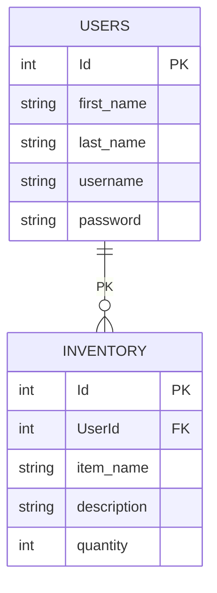

## Getting Started

### 1. Start the database

Run PostgreSQL in Docker. The `POSTGRES_DB` variable creates the `crud_app` database, and the password matches `server/knexfile.js`:

```bash
docker run --name pg-docker \
  -e POSTGRES_PASSWORD=docker \
  -e POSTGRES_DB=crud_app \
  -d \
  -p 5432:5432 \
  -v $HOME/docker/volumes/postgres:/var/lib/postgresql/data \
  postgres:14
```

### 2. Set up and start the server

```bash
cd server
npm install
npx knex migrate:latest
npx knex seed:run
npm start
```

### 3. Start the client

In a new terminal:

```bash
cd client
npm install
npm run dev
```

Open the client at http://localhost:5173

### Test accounts

The seed creates three users, all with the password `password`:

| Username | Password |
| -------- | -------- |
| jsmith   | password |
| bwayne   | password |
| aketchum | password |

Or click **Continue as Guest** to browse all items without logging in.

## API Endpoints

| Method | Endpoint         |
| ------ | ---------------- |
| POST   | `/login`         |
| GET    | `/users`         |
| POST   | `/users`         |
| GET    | `/inventory`     |
| GET    | `/inventory/:id` |
| POST   | `/inventory`     |
| PATCH  | `/inventory/:id` |
| DELETE | `/inventory/:id` |

## Requirements

- [x] As an inventory manager I want to be able to create an account so that I can track my inventory.

- [x] As an inventory manager I want to be able to log into my account so that I can see my inventory of items.
  - [x] After logging in, the inventory manager should be redirected to their inventory of items.

- [x] As an inventory manager I want to be able to create a new item so that I can share my item details with the world.
  - [x] After the item is created, the inventory manager should be redirected to their inventory of items.
  - [x] An item displays name, description, and quantity.

- [x] As an inventory manager I want to be able to see a my entire inventory of items.
  - [x] The inventory of items should display the first 100 characters of each item description, with “...” at the end if the description is longer than 100 characters.

- [x] As an inventory manager I want to be able to see any individual item I have added.
  - [x] The full item information should be displayed.

- [x] As an inventory manager I want to be able to edit an item so that I can fix any mistakes I made creating it.
  - [x] When the user toggles edit mode, the page remains the same and the fields become editable.

- [x] As an inventory manager I want to be able to delete an item so that I can remove any unwanted content.
  - [x] When the user deletes the item they should be redirected to their inventory of items.

- [x] As a visitor, who is not logged in, I want to be able to view all items created by every inventory manager so that I can browse every item.
  - [x] Unauthenticated users should be able to view all items, and any single item.
  - [x] The items should only display the first 100 characters of its description with “...” at the end if it is longer than 100 characters.

- [x] As a visitor, who is not logged in, I want to be able to view a specific item created by any user so that I can see all of its details.
  - [x] Unauthenticated users should be able to view all items, and any single item.

- [x] As an inventory manager I want to be able to view all items created by every inventory manager so that I can browse every item.
  - [x] Unauthenticated users should be able to view all items, and any single item.


